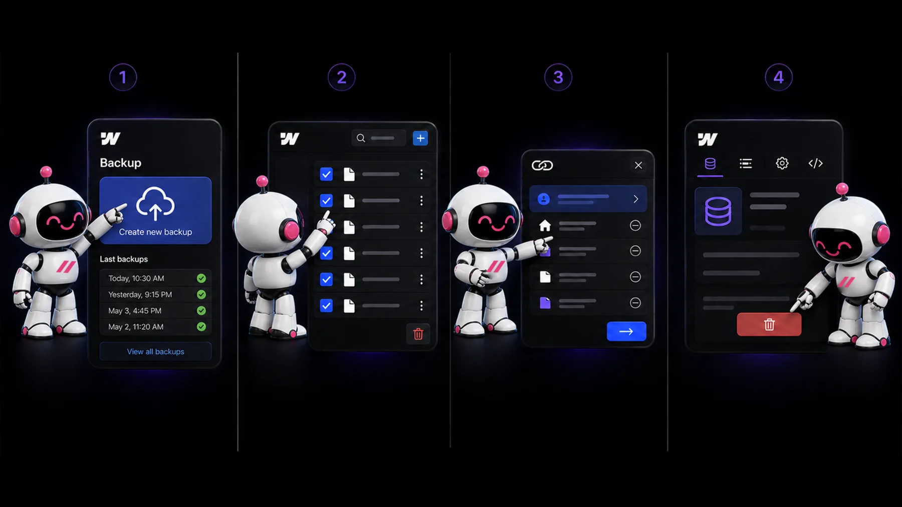
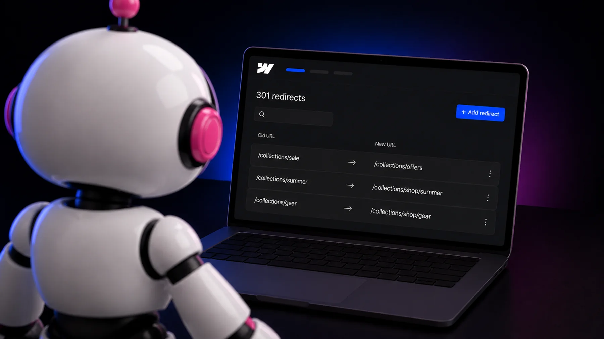

<aside class="prose_callout" aria-label="Key takeaways">

**Key takeaways**

- Deleting a CMS collection page in Webflow is simple to do and easy to get wrong, since it can break links, dynamic content, and your SEO.
- The safe way: back up first, because deletion can't be undone, then delete the collection items, remove every connection, and delete the collection itself.
- Set up 301 redirects for the old URLs to protect your SEO, consider unpublishing if you might need the content later, and test everything afterward.

</aside>

## Deleting a collection page isn’t just a design action

A CMS collection page in Webflow is a dynamic template that automatically generates a page for every item in a collection, every blog post, case study, or product, for example. Because these pages often power content that ranks in search and links throughout your site, deleting one is a structural change, not just a bit of tidying up. Done carelessly, it can leave broken links, empty sections, and lost search rankings. Done properly, it’s straightforward and safe. This guide walks through the safe way, based on Webflow’s own process.

## Before you delete: back up first

This is the step people skip and regret. Deleting a collection **cannot be undone**, unless you restore from a backup. So before you touch anything, save a manual backup of your site by pressing Command + Shift + S on Mac, or Control + Shift + S on Windows. It takes a second and it’s your safety net if something goes wrong. If the collection pages hold content you might want later, it’s also worth exporting the content first.

## How to delete the collection page, step by step

Webflow won’t let you delete a collection while things are still connected to it, which is a safeguard against losing data that’s used elsewhere. So the process goes in order:

1. Back up your site (see above).
2. Delete the collection items. In the CMS panel, open the collection, select all items (bulk-edit), and delete them. Wait for the site to save.
3. Remove all connections. In the collection’s settings, click “View Connections” to see every page, template, and symbol tied to the collection. Disconnect each instance, Webflow lets you do this in one click per connection.
4. Delete the collection. Once every item and connection is gone, go to the CMS panel, open the collection settings, and click Delete. This also removes the collection page.

One thing worth knowing: deleting the collection page template alone doesn’t delete the collection itself. If you want the whole thing gone, you delete the collection (which removes the page). If you only want to remove specific pages, that’s a different situation, and often **unpublishing** is the better move (more on that below).

## The step people forget: set up redirects

This is the most important step for anyone who cares about SEO, and the one most tutorials rush past. If the collection pages you’re deleting rank in Google or are linked to from elsewhere, deleting them without redirects means anyone who visits those URLs hits a broken page, and you lose the search equity those pages built. The fix is to set up **301 redirects** that point the old URLs to a sensible new destination (a related page, or the relevant section of your site). Properly implemented redirects preserve the large majority of that link equity. In Webflow, you add redirects in your site settings, and for a whole collection you can often set one redirect rule rather than one per item. If you take one thing from this guide, make it this: never delete ranking pages without redirects.

## When to unpublish instead of delete

Deletion is permanent, and it isn’t always the right call. If you’re restructuring your site, pausing content, or think you might need the collection again, there are gentler options that keep your structure intact. You can unpublish collection pages to hide them temporarily without deleting anything, which is ideal when you’re mid-redesign or reworking your content. You can also keep the collection but stop linking to it, if the issue is visibility rather than the data itself. The rule of thumb: if you’re certain you’ll never need it again, delete it properly with redirects. If there’s any doubt, unpublish instead, it’s reversible, and it costs you nothing.

## Test your site after deleting

Deletion can have knock-on effects, so always check your site afterward rather than assuming it worked cleanly. Test the old URLs in an incognito window to confirm your redirects resolve properly instead of landing on broken pages. Walk the pages that used to display the collection to make sure no layouts broke or sections are sitting empty. And if the collection was tied to any forms, automations, or integrations, verify those still work. A few minutes of checking catches problems before your visitors, or Google, do.

## Quick recap

Deleting a CMS collection page in Webflow is safe when you do it in order: back up first, delete the items, remove every connection, delete the collection, and, crucially, set up 301 redirects so you don’t break links or lose SEO. If there’s any chance you’ll need the content again, unpublish instead of deleting. And always test afterward. Handled this way, restructuring your CMS is a clean, low-risk change rather than a source of broken pages and lost rankings.

## Frequently asked questions

### Does deleting a CMS collection also delete its collection page?

Yes. Deleting a collection automatically removes its collection page, since the page is generated from the collection. Note the reverse isn’t true: deleting the collection page template alone doesn’t delete the collection itself, which stays in your CMS until you delete it directly.

### Can you undo deleting a CMS collection in Webflow?

No, deletion can’t be undone unless you restore your site from a backup. That’s why saving a manual backup (Command/Control + Shift + S) before you delete anything is essential. If the content matters, export it first too.

### Why won’t Webflow let me delete my collection?

Because something is still connected to it. Webflow blocks deletion while collection items exist or while pages, symbols, or elements reference the collection, to prevent data loss. Use “View Connections” in the collection settings to find and disconnect every instance, then you’ll be able to delete it.

### How do I delete a collection page without hurting my SEO?

Set up 301 redirects from the old URLs to a relevant new page before or immediately after deleting. This preserves most of the search equity those pages built and stops visitors hitting broken pages. Skipping redirects on pages that rank is the single most damaging SEO mistake when deleting collections.

### Should I delete or just unpublish my collection page?

If you’re certain you’ll never need it again, delete it properly with redirects. If you’re restructuring, pausing content, or might need it later, unpublish instead, it hides the page without deleting anything and is fully reversible.
