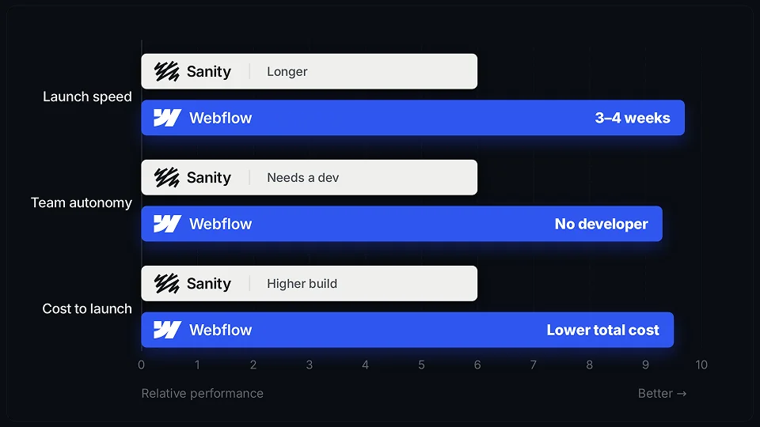

<aside class="prose_callout" aria-label="Key takeaways">

**Key takeaways**

- Sanity and Webflow CMS solve different problems, so the comparison isn't about which is better.
- Sanity is a headless platform for content that has to go to many places at once, a website, an app, in-store screens, a product catalogue, and it needs a developer from day one.
- Webflow CMS is for websites where design and content live together and the marketing team publishes without a developer.
- The real question isn't which platform wins. It's where your content actually needs to go.

</aside>

## The real difference, in one sentence

Sanity stores your content as structured data and delivers it anywhere through APIs. Webflow keeps your content and your design together in one place, where the website is the destination. That single distinction is the whole comparison. Almost everything else, cost, speed, who can use it, follows from it. So before comparing features, it's worth being honest about which of those two models fits how your content actually moves.

## What Sanity is good at

Sanity started as a headless CMS and now calls itself a content operations platform. The label sounds vague, but it points at something specific: Sanity is built for content that has to live in more than one place.

### Content that goes to many places

This is Sanity's core strength. You model a piece of content once, a product description, a legal disclaimer, a bio, and it can feed your website, your mobile app, a partner feed, and a screen in a store, all from one record. Change it in one place and it updates everywhere. If your content genuinely has to reach several surfaces, nothing about a website-first tool comes close to this.

### Flexibility, if you have a developer

Sanity doesn't hand you a finished editor and a finished site. It gives your developers a fully customisable editing app they shape around how your team actually works, and leaves the front end for them to build, usually in a framework like Next.js or Astro. That's real flexibility, but it comes with a condition: you need a developer from day one. There's no theme, no template, and no page builder to start from.

### Built for structured content and AI

Because Sanity stores content as data rather than as a blob of HTML, machines can actually read it. An AI tool looking at a page of HTML can't tell a product claim from a legal disclaimer, since the formatting carries no meaning. Structured content keeps those distinctions intact, which matters both for generating content at scale and for how accurately answer engines represent you when they pull from your pages.

## What Webflow CMS is good at

Webflow CMS takes the opposite approach. Instead of separating content from the front end, it keeps design and content in the same tool. That has real consequences for how fast a team moves.

### Design and content in one place

In Webflow, the people who write the content and the people who design the pages work in the same environment. A marketer can update a page, publish a new blog post, or launch a landing page without waiting on a developer to wire anything up. Losing that visual connection to the page is the loudest complaint teams have about going headless, and Webflow simply doesn't have that problem, because the page is right there.

### Speed to launch

Because there's no separate front end to build, a Webflow site goes live far faster than a headless setup. There's no content-modelling exercise and no framework build standing between kickoff and launch. For a marketing website, that difference is often weeks.

### No developer for every change

Once a Webflow site is built well, the client's own team runs it. Adding pages, editing content, and shipping updates don't require a developer each time. For a marketing team that needs to move at its own pace, that independence is usually the whole point.

## Where each one struggles

Neither is the right answer for every team, and the honest way to choose is to look at where each one falls down, not just where it shines.

### Sanity's real cost is the build, not the subscription

Sanity's pricing looks friendly on paper. There's a genuinely generous free tier, and the paid Growth plan is around $15 per seat per month. But the subscription is the smaller number. Because developers have to design the content model and build the front end before anyone publishes a page, the initial implementation usually costs more than the subscription in the first year. Usage-based overages and AI credits then make the total harder to forecast. The headline price is real, it just isn't the whole bill.

### Webflow CMS is scoped to the website

Webflow's limit is the flip side of its strength. Its CMS is built for the website, so the moment your content has to leave the site and live somewhere else, an app, a kiosk, a product catalogue, Webflow CMS isn't the tool for that job. It also has practical caps on collection size and structure that a very large, complex content operation can outgrow. If the website is the channel, none of that matters. If it isn't, it matters a lot.

## How to actually choose

Strip away the feature lists and one question decides it: where does your content need to go? If the answer is your website, and nowhere else, Webflow CMS is almost certainly the right call. It ships faster, costs less, and lets your marketing team run the site without a developer standing by. If your content has to serve several places at once, an app, in-store screens, a catalogue, a help centre, then Sanity's model is built for exactly that, and the flexibility you pay for is flexibility you'll actually use. Count your channels honestly, today and where your roadmap is realistically heading, and the answer tends to pick itself. And if you're genuinely on the line between the two, that's usually a sign the simpler option will serve you better until something forces the change.

## Frequently asked questions

### Is Sanity better than Webflow CMS?

Neither is better in general, they solve different problems. Sanity is built for content that has to live in multiple places at once (a website, an app, in-store screens). Webflow CMS is built for websites where design and content live together and the marketing team publishes on its own. The right choice depends on where your content needs to go, not which platform is "better."

### Can marketing teams use Sanity without a developer?

Not really. Sanity needs a developer from day one, both to build the front end and to set up the content model. There's no template or page builder to start from. This is the main difference from Webflow CMS, where a marketing team can update content, publish pages, and launch campaigns without waiting on a developer.

### Is Webflow CMS good enough for a large website?

For most marketing websites, yes. Webflow CMS handles design, content, and publishing in one place and scales well for a single site. Its limit is scope, not size: it's built for the website. Once your content has to leave the site and feed an app, a catalogue, or other channels, Webflow CMS isn't the tool for that job.

### Is Sanity or Webflow cheaper?

Sanity's subscription looks cheaper on paper, with a generous free tier and a paid plan around $15 per seat per month. But the real cost is the build: developers have to design the content model and build the front end before anyone publishes, which usually costs more than the subscription in the first year. Webflow's cost is more predictable, since the platform and the build are the same thing.
