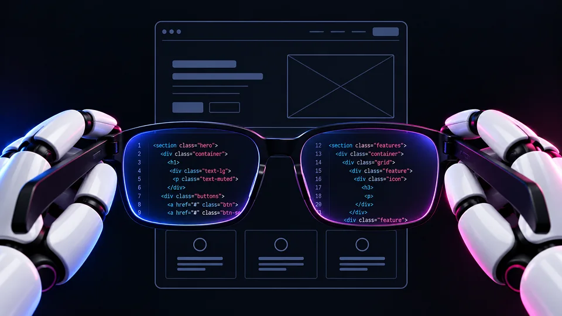

<aside class="prose_callout" aria-label="Key takeaways">

**Key takeaways**

- Source is a new Webflow platform where marketing teams and AI agents build and optimize websites together. It's currently in a limited research preview.
- The biggest change is that it works directly on code instead of a visual abstraction layer, which gives its agents far more to work with.
- The Webflow you already use isn't going anywhere.

</aside>

## What Source actually is

Webflow has announced Source, a new platform built around marketing teams and AI agents working on the web together. It's a bigger shift than a new feature, so it's worth understanding what it is before deciding what it means for you.

### A shared platform for marketers and agents

Source is a single environment where marketers, designers, developers and AI agents work side by side. Everyone gets a workspace shaped around the job they own, with the tools and access they need already in place. The idea is that more of a team can contribute to the website safely, with agents handling the heavier or more repetitive work alongside them.

### Still in research preview

Source isn't publicly available yet. It's in a limited research preview, which means Webflow is rolling it out to select partners and customers in phases over the coming months. So this isn't something most teams can use today, it's a look at where the platform is heading.

### It connects to the stack you already use

Source is built to connect to your existing codebase, CMS, and martech stack, including sites already built in Webflow. You can bring your own stack or use more of Webflow's, and Source provides the workspaces, governance, and agent layer on top. Nothing here requires throwing out what you already have.

## The big shift: code as the foundation

The most important thing to understand about Source is what sits underneath it. This is where it departs from how Webflow has always worked.

### Why code instead of a visual layer

Classic Webflow is visual-first. You work on a canvas, and Webflow generates the code underneath. Source flips that: it works directly on the code that actually ships, not on an abstraction layer above it. The reason is simple. Code is the native language of AI, so when agents can read and write the real code, they can do far more than they can through a visual layer.

### What that unlocks for agents

When an agent works directly with the code that ships, it can understand the whole system, make changes across it, and check its own work, rather than being limited to what a visual interface exposes. That's what lets Source treat agents as genuine teammates that can take on larger, more complex changes, instead of tools you prompt one step at a time.

### How it differs from classic Webflow

In short: classic Webflow is visual with code generated underneath, and Source is code-first with visual control layered on top. You can still take direct visual control for craft and precision when it matters, or let an agent handle the heavy lifting. The difference is what the foundation is built on, and what that makes possible.

## What the agents actually do

The agents in Source aren't just a chat box you send requests to. They're designed to work in the background and stay ahead of what you ask.

### Always on, ahead of the ask

Source's agents run continuously. When there's an opportunity to improve something, an AEO fix, a CRO test worth running, a page slipping on conversion, they flag it in your inbox with the work already drafted and ready for review. You're not starting from a blank prompt each time; the agent has already done a first pass.

### You stay in control

Nothing ships without your say-so unless you decide otherwise. You choose how much autonomy agents have, from requiring approval before anything changes to giving them more room for lower-risk work. Either way, agents operate under the same roles, permissions, and review paths as human teammates, with a record of what changed and who, or which agent, made the change.

## What happens to the Webflow you already use

If you've built your site on Webflow, this is the question that matters most. The short answer is that nothing is being taken away.

### The current platform isn't going anywhere

Webflow has been clear that the platform hundreds of thousands of teams use every day isn't going anywhere, and that they'll keep investing in it. You've already seen that in recent releases like MCP 2.0, native AEO agents, and AI Code Components, with more on the roadmap. Source is a new platform being built alongside the existing one, not a replacement dropped on top of it.

### A supported path when Source is ready

When Source is ready and if you choose to move to it, Webflow has said it will provide a supported migration path. In practical terms, there's nothing you need to do right now. You can keep building the way you do today and pay attention to Source as it develops.

## What it means for teams on Webflow

Source is still a preview, so the honest takeaway isn't to change anything today. It's a clear signal of where web development is heading: AI agents working directly on code, handling routine work in the background while people stay in control of what ships. The direction is set, even if the tool is early. For now, the smart move is to follow how it develops rather than react to it, and to keep building sites that are fast, clean, and easy to work on, because that's what makes any of this easier to adopt when the time comes.

## Frequently asked questions

### What is Source by Webflow?

Source is a new platform from Webflow where marketing teams and AI agents build and optimize websites together. Unlike classic Webflow, which is visual-first, Source works directly on the code that ships, which gives its AI agents far more to work with. It's currently in a limited research preview.

### When will Source be publicly available?

Source isn't publicly available yet. It's in a limited research preview, which Webflow is rolling out to select partners and customers in phases over the coming months. Webflow hasn't announced a general release date, so the honest answer is that there isn't a public timeline yet.

### Does Source replace the Webflow I already use?

No. Webflow has been clear that the platform teams use today isn't going anywhere, and that they'll keep investing in it. Source is a separate platform being built alongside the existing one. When it's ready, and if you choose to move to it, Webflow says it will provide a supported migration path.

### Why does Source work on code instead of a visual editor?

Because code is the native language of AI. When agents can read and write the real code that ships, rather than a visual layer above it, they can understand the whole system, make changes across it, and check their own work. That's what lets Source treat its agents as genuine teammates rather than tools you prompt one step at a time.
