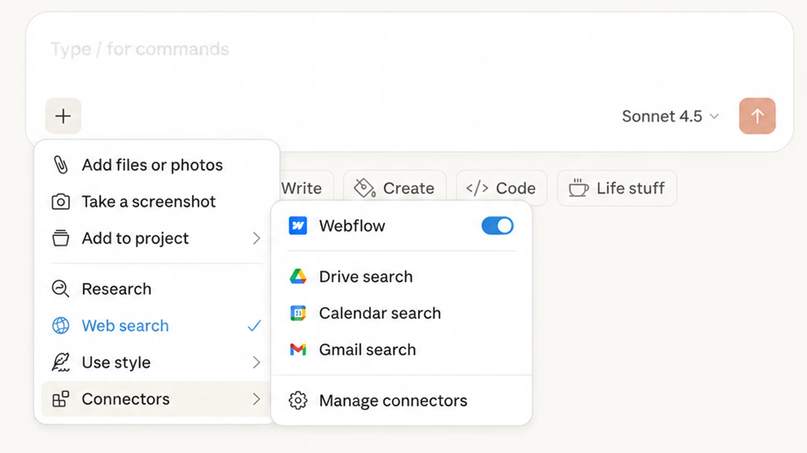
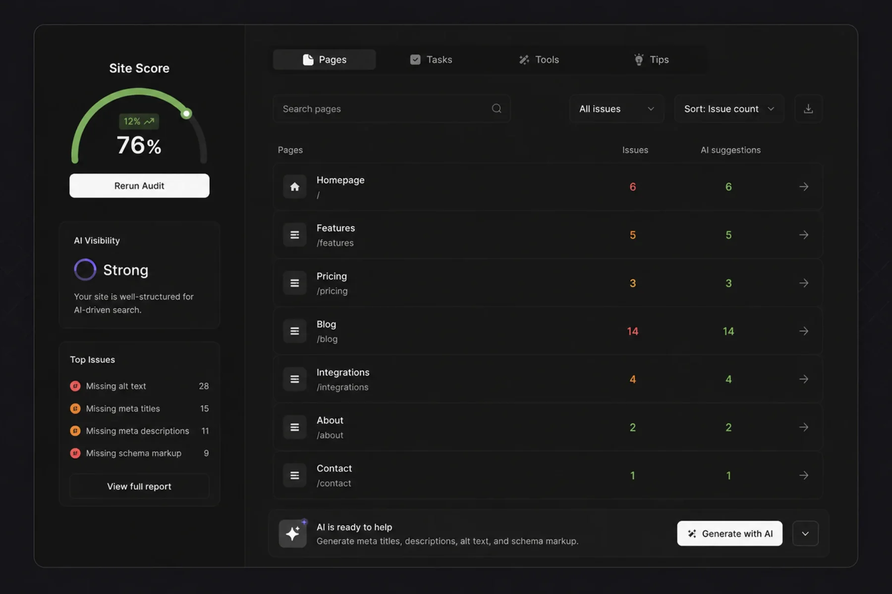

<aside class="prose_callout" aria-label="Key takeaways">

**Key takeaways**

- Webflow has released more features in the first half of 2026 than it has in some entire years.
- Three of them are genuinely worth paying attention to: the Claude connector, AI-powered SEO and AEO tools, and real-time collaboration. One isn’t.

</aside>

Webflow has been busy. The first half of 2026 has brought a Claude connector, AI-powered SEO and AEO tools, real-time collaboration, single-page publishing, AI Site Builder updates, native GSAP animations, and a migration of the entire hosting infrastructure to Cloudflare. That’s before counting the smaller updates that didn’t make the keynote.

A list of every new feature is interesting for about two minutes. What matters more is which ones actually change how you work. I’ve spent the last few weeks looking at what’s launched, reading what other agencies are saying, and asking around. Here are the three I’d pay attention to right now, and one I wouldn’t.

## Worth paying attention to

Three features from the first half of 2026 are worth your attention, each for a different reason.

### The Claude connector

The Claude connector launched on February 9, 2026, and it’s the kind of feature that sounds smaller than it is. Once you connect it (which takes about five minutes through Claude’s settings panel), Claude gets direct access to your Webflow project. From there, you can use natural language to run audits, generate copy, [update CMS items in bulk, translate content across the site](/blog/how-to-delete-a-cms-collection-page-in-webflow-without-breaking-your-site), or build out landing pages.

The honest version is this: AI helps a lot when you use it the right way. You still have to review everything it produces because nothing it generates is production-ready out of the box. But it cuts the time on tasks that used to take hours. SEO audits across a CMS collection, content refreshes, bulk metadata updates, all the kind of work that used to feel mechanical now runs in the background while you focus on harder problems.

The Claude connector won’t write a brand strategy or pick your design system. It also won’t replace a developer when something custom needs to be built. What it does well is take the repetitive parts of running a site and make them faster. For marketing teams, that alone is worth the setup time.

### AI-powered SEO and AEO tools

Webflow launched [AI-powered SEO and AEO tools](/blog/aeo-vs-seo-in-2026-whats-the-difference-and-why-it-matters) on October 29, 2025, and the basic version is available on any paid plan. The tools audit your site for missing alt text, meta titles, meta descriptions, and schema markup, then help you generate the missing pieces with AI.

This is a game changer for marketing teams, and the reason is structural. Generating schema markup used to be a developer task. Writing alt text for a few hundred images used to be a half-day job. Producing meta descriptions across a CMS collection of blog posts used to be the kind of work that gets pushed to next quarter and never happens. All of that now runs through the AI tools directly in Webflow.

There’s a bigger picture here too. AEO, or Answer Engine Optimization, is becoming as important as traditional SEO. According to Webflow’s own State of the Web, 52% of marketing leaders plan to optimize for AI-driven search in 2026. The tools help with that, not by gaming the system, but by making sure your content is structured cleanly enough for AI systems to read, understand, and quote accurately.

The catch is the same as with Claude: the AI gives you a strong starting point, not a finished output. Auto-generated alt text and meta descriptions still need human review before they ship. But the speed gain is real, and unlike a lot of AI features, this one isn’t gated behind Enterprise pricing.

### Real-time collaboration

Real-time collaboration is the most quietly important update of the year, and the one I’d argue agencies will feel the most. It rolled out to all plans on October 23, 2025, and as of February 25, 2026, it became a permanent baseline across every Webflow site, including free Starter accounts.

The pitch is simple: multiple people can work on the same Webflow project at the same time, without anyone having to hand off control. Avatars appear in the top-right corner of the canvas. Colored outlines mark the element each person is editing. It works closer to Google Docs than to Figma, with conflicts resolved by keeping the last saved change.

For agencies running multiple projects in parallel, this changes the daily workflow. There’s no more waiting for someone to finish what they’re doing before you can fix a typo. There’s no more handing the Designer back and forth before a client review. A designer, a developer, and a marketer can all be in the same site at once, each working on their part of it.

It’s not perfect. There’s no live cursor, so you see element highlights, not cursor movement. Text syncs when you click out of a field, not keystroke-by-keystroke. Sites built with legacy interactions aren’t compatible. But for the kind of work most agencies do, the limitations are minor compared to the gain in throughput.

The best part is that it’s free. Real-time collaboration is included on every plan, no upgrade required. The more advanced governance features like page branching and design approvals are Enterprise-only, but most agencies don’t need those to get the core benefit.

## One to skip: single-page publishing

Single-page publishing lets you push changes to one page at a time instead of republishing the entire site. On paper, it sounds useful. In practice, it solves a problem most teams don’t actually have.

Webflow’s full-site publish takes seconds. The friction of republishing a whole site to push a one-page update was always more theoretical than real. If you have a CMS-heavy site with hundreds of pages and you’re editing one blog post, the difference between single-page and full-site publish is measured in seconds, not minutes.

The teams this might matter for are very large Webflow sites with strict deployment workflows where any change to production has to go through review. That’s a narrow audience. For everyone else, this is a solution looking for a problem. There’s no reason to change your workflow to use it, and forgetting it exists won’t slow anyone down.

## What this means

Webflow’s 2026 updates point in one clear direction: the platform is becoming more useful for marketing teams that want speed without sacrificing control. The Claude connector, AI SEO/AEO tools, and real-time collaboration each address a different kind of friction. AI handles the repetitive work. Collaboration removes the wait time. SEO automation closes the gap between marketing and what used to be a developer task.

Not every new feature is worth your attention. Some, like single-page publishing, look interesting on a release page and then sit unused. But the three I’ve highlighted have already changed how a lot of teams work, and they’re likely to keep mattering as the rest of the year unfolds.
