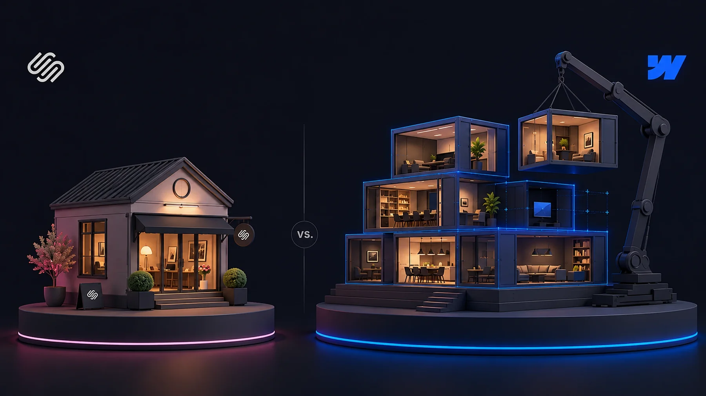
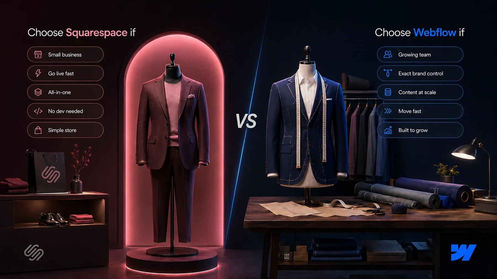

<aside class="prose_callout" aria-label="Key takeaways">

**Key takeaways**

- Webflow and Squarespace solve different problems.
- Squarespace is built for getting a polished site live fast, with everything included, ideal for small businesses, solo founders, and anyone who wants simplicity over control.
- Webflow is built for design control, content at scale, and marketing teams that need to move fast without a developer, which is where growing B2B companies land.
- This guide covers where each one wins, how they compare on design, CMS, e-commerce, and pricing, and how to decide based on where your business actually is.
- The short version: Squarespace is excellent until you outgrow it, and Webflow is where you go when you do.

</aside>

## The real difference between Webflow and Squarespace

Most comparisons frame this as a fight, with a winner at the end. That’s the wrong way to look at it. Webflow and Squarespace are built on different philosophies, for different kinds of users, and the better question isn’t which is better in the abstract. It’s which fits the site you’re trying to build.

Squarespace is built around guided simplicity. You pick a beautiful template, fill it with your content, and you have a polished, professional site live in an afternoon. Everything is included: hosting, a domain, e-commerce, email marketing, analytics, all in one subscription. The trade-off you accept is control. You work within the template’s structure, and when you want something it wasn’t designed to do, you hit a wall.

Webflow is built around control. It gives you near-code-level command over design, a CMS that scales to complex content, and the freedom to build almost anything without writing code yourself. The trade-off is that this power takes time to learn, and getting the most out of it usually means working with an experienced developer or agency. Webflow rewards the investment with a site that can grow in any direction, but it asks for that investment up front.

That’s the real difference. Squarespace optimizes for getting live fast with less control. Webflow optimizes for control and scale at the cost of simplicity. Neither is wrong. They’re built for different stages and different needs, and the rest of this guide is about figuring out which one is yours.

| Area               | Squarespace                     | Webflow                      |
| ------------------ | ------------------------------- | ---------------------------- |
| Best for           | Small business, solo, creatives | Growing B2B, marketing teams |
| Design control     | Template-based, curated         | Pixel-level, near-code       |
| Learning curve     | Gentle, DIY-friendly            | Steep, 40-60 hours           |
| CMS                | Good for basic content          | Built for content at scale   |
| E-commerce         | Strong, on every plan           | Capable, higher tiers        |
| Marketing autonomy | Limited by template             | Ship and test freely         |
| All-in-one         | Yes, fully bundled              | More modular                 |
| Needs a developer  | No, built for DIY               | Often an agency or dev       |
| Entry pricing      | From around $16/mo              | From around $15/mo           |
| Room to grow       | Hits a ceiling eventually       | Scales in any direction      |

## When each one fits

One gets you online fast, the other grows with you. Which is right depends on your needs and where you’re headed.

### When Squarespace is the right choice

It would be dishonest to treat Squarespace as the lesser option. For a large set of businesses, it’s the smarter pick, and here’s where it genuinely wins.

If you’re a small business, a solo founder, or a creative professional who needs a professional site quickly and cheaply, Squarespace is hard to beat. The templates are genuinely beautiful, the editor is intuitive, and you can go from nothing to a live, polished site in a day without hiring anyone. For a restaurant, a photographer, a consultant, or a local service business, that speed and simplicity is exactly what’s needed.

If you want everything in one place with no assembly required, Squarespace’s all-in-one approach is a real advantage. Hosting, domain, e-commerce, email marketing, scheduling, and analytics come bundled. You don’t think about plugins, integrations, or technical setup. For a business owner who wants to run their business, not their website, that bundling removes a genuine burden.

If you want to sell simply, [Squarespace’s e-commerce](https://www.squarespace.com/ecommerce-website) is strong out of the box. Every plan includes the ability to take payments, and the platform handles product listings, shipping, in-person POS, and multi-channel selling without add-ons. For a small online store or a business adding a shop to its site, Squarespace’s commerce is more accessible than Webflow’s, especially on lower-priced plans.

If you don’t have a developer and don’t want one, Squarespace is designed for exactly that. It’s built for DIY use, and most people can run their own Squarespace site indefinitely without technical help. That self-sufficiency is part of its appeal, and for many businesses it’s the deciding factor.

The pattern across these cases is that Squarespace wins when simplicity, speed, and self-sufficiency matter more than control and scale. For a lot of businesses, that’s the right trade, and choosing Squarespace is the smart call, not a compromise.

### When Webflow is the better choice

Webflow becomes the better platform when your needs outgrow what guided simplicity can offer. For growing B2B companies, marketing teams, and content-driven businesses, that point usually arrives sooner than expected.

The clearest reason is design control. Webflow gives pixel-level command over layout, animation, and responsive behavior, which means your site can match your brand exactly rather than approximating it within a template. For a company whose website is a core part of how it’s perceived, the difference between “looks like our brand” and “looks like a Squarespace template” is real, and it compounds as the brand matures.

The second reason is content at scale. [Webflow’s CMS](https://webflow.com/cms) handles complex, interrelated content in a way Squarespace’s simpler system can’t. If you’re running a serious blog, a growing case study library, a resource center, or programmatic landing pages, Webflow’s CMS is built for that scale. Squarespace handles a basic blog fine, but it wasn’t designed for content operations that grow into the hundreds of items with custom structures.

The third reason is marketing autonomy. This is where Webflow quietly pulls ahead for B2B teams. A marketing team can build landing pages, run tests, and ship changes without waiting on engineering, and without being boxed in by a template. For a team whose job is to keep the site moving at the speed of the business, that freedom is the whole point, and it’s something a template-based platform structurally can’t match.

The fourth reason is room to grow. A Webflow site doesn’t hit a ceiling the way a template-based site eventually does. Whatever you need next, a custom integration, a complex interaction, a new content type, a redesign without starting over, Webflow can accommodate it. For a business that expects its website needs to get more demanding over time, that headroom matters.

The honest framing is that Webflow is the better choice when control, scale, and marketing speed start to matter more than simplicity. That’s usually a growing company with a marketing team and a website that has real work to do, which is a different situation from the small business Squarespace serves so well.

## Details that matter

Where the two genuinely differ, feature by feature.

### Design and customization

This is the starkest difference between the two, and it’s worth being specific about.

Webflow offers near-complete design freedom. You control layout, spacing, typography, animation, and responsive behavior down to the pixel, and the platform generates clean, professional code underneath. Designers can replicate a brand system exactly, build custom interactions, and create something genuinely distinctive. The catch is the learning curve. Most people need somewhere in the range of 40 to 60 hours to become proficient with Webflow’s interface and concepts like classes and flexbox, which is why serious Webflow work is often done by an agency or experienced developer.

Squarespace takes the opposite approach. It offers a curated set of around 300 professionally designed templates, and you customize within their structure. You can adjust colors, fonts, images, and content easily, but you’re working inside the template’s design decisions rather than making your own from scratch. For most users this is a feature, not a limitation, because the templates are well-made and the constraints keep the result looking polished. The limit shows up when you want something the template wasn’t built for, where advanced customization often requires workarounds or custom code.

The simple way to think about it: Squarespace gives you a beautiful set of options to choose from, and Webflow gives you a blank canvas and the tools to build anything. One values guardrails, the other values freedom. Which is right depends on whether your priority is a polished result fast, or a custom result that’s exactly yours.

### CMS and content scaling

If content is central to your strategy, the two platforms diverge quickly.

Squarespace’s CMS handles the basics well. A blog, a portfolio, a simple collection of items, all of these work cleanly and are easy to manage. For a business that publishes occasionally and doesn’t need complex content structures, it’s perfectly capable.

Webflow’s CMS is built for scale and complexity. It supports many interrelated content types, relational references between them, dynamic filtering and sorting, and template pages that generate automatically from CMS content. For a marketing operation publishing case studies, comparison pages, integration pages, and a regular blog, all with custom structures, Webflow’s CMS does work that Squarespace’s simpler system isn’t designed for. As content grows from dozens of items to hundreds, that difference becomes the difference between a system that scales and one you fight against.

This matters most for B2B and content-driven companies. If your growth depends on publishing a lot of structured content over time, the CMS is not a minor detail, it’s the engine of your marketing. Webflow gives that engine far more room to run.

### E-commerce

Here the comparison flips from the rest of the guide, and it’s worth being honest about.

For simple, accessible e-commerce, Squarespace is the stronger choice. Every Squarespace plan includes the ability to take payments, and the platform bundles product management, shipping, in-person POS, and multi-channel selling without extra tools. For a small store, a business adding a shop, or anyone who wants to start selling quickly without technical setup, Squarespace’s commerce is more approachable, especially on its lower-priced plans where Webflow doesn’t include payment processing at all.

[Webflow’s e-commerce](https://webflow.com/ecommerce) is capable but positioned differently. It gives you full design control over the shopping experience and works well for limited-to-medium catalogs, but it shows up on higher-tier plans and generally suits businesses that want a custom storefront over a quick one. For a content-driven B2B company that sells a few things, it’s fine. For a business whose primary model is e-commerce, especially a smaller one, Squarespace’s all-in-one commerce is usually the more practical pick.

The honest takeaway: if selling is central to your business and you want it simple, Squarespace has the edge here. If e-commerce is secondary to a content or marketing site and you want it to match a custom design, Webflow works well. This is one area where Squarespace genuinely leads for a lot of use cases.

### Pricing and total cost

On paper, the two are priced similarly. [Webflow’s paid site plans](https://webflow.com/pricing) start around $15 a month and [Squarespace’s](https://www.squarespace.com/pricing) start around $16, so at the entry level there’s little between them. Both also offer a free trial period to test before committing, and both regularly adjust their pricing, so it’s worth checking the current plans on their sites.

The real cost picture has some nuance, though. Webflow adds a transaction fee on its lower e-commerce tiers, and because Webflow’s power often means working with an agency or developer, the true cost of a Webflow project usually includes that build investment. Squarespace’s cost is more self-contained, since most people build and run it themselves, so the subscription is closer to the full cost.

The honest way to read pricing is not which subscription is cheaper, because they’re close, but what the total investment looks like for your situation. A solo business owner building their own Squarespace site has a low, predictable cost. A growing company building a custom Webflow site with an agency is making a larger investment, but it’s buying a different class of website. Comparing only the monthly subscription misses most of the real picture.

## A decision framework

Here’s the simplest way to decide, based on everything above.

### Choose Squarespace if most of these are true:

- You’re a small business, solo founder, or creative professional
- You want a polished, professional site live quickly and cheaply
- You want everything bundled with no technical setup
- You’re running a simple online store and want commerce that works out of the box
- You don’t have a developer and don’t want one
- Simplicity matters more to you than total control

### Choose Webflow if most of these are true:

- You’re a growing company with a marketing team
- Your website is central to how your brand is perceived and needs to be exactly right
- You’re publishing content at scale, with a blog, case studies, or a resource library
- Your marketing team needs to move fast without being boxed in by a template
- You expect your website needs to get more demanding over time
- You have, or are willing to work with, an experienced developer or agency

The honest summary. Squarespace is excellent at what it’s for: getting a polished, all-in-one site live fast, with no technical overhead. For a huge number of businesses, that’s exactly right, and Webflow would be overkill. Webflow is for when you outgrow that, when control, content scale, and marketing speed start to matter more than simplicity. Many successful businesses start on Squarespace and move to Webflow when they hit its limits, and that’s a perfectly sensible path. The question isn’t which platform is better. It’s which one matches where your business is now, and where it’s going next.

## Frequently asked questions

### Which is easier for beginners, Webflow or Squarespace?

Squarespace, clearly. It’s designed for non-technical users to build a polished site themselves in a day, with no learning curve to speak of. Webflow is far more powerful but takes real time to learn, which is why serious Webflow sites are often built by an agency. For a genuine beginner who wants to do it themselves, Squarespace is the easier path.

### Can you switch from Squarespace to Webflow?

Yes, and many businesses do once they outgrow Squarespace. Content and SEO can be carried over with proper planning and a full redirect map so you don’t lose rankings. It’s a rebuild rather than a one-click import, since the platforms work differently, but it’s a well-trodden path.

### Is Squarespace or Webflow better for a small online store?

For a simple store run by its owner, Squarespace usually wins, since commerce is included on every plan and works out of the box with no setup. Webflow’s e-commerce gives more design control but suits a custom storefront more than a quick one. If selling simply is the priority, Squarespace has the edge.

### Is Webflow worth it over Squarespace?

It depends on where your business is. If you need a simple, polished site and run it yourself, Squarespace is likely all you need and Webflow would be overkill. Webflow is worth it when design control, content at scale, and marketing speed start to matter more than simplicity, usually a growing company with a marketing team.
