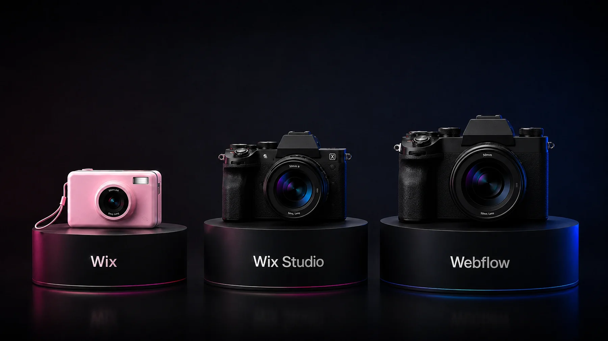
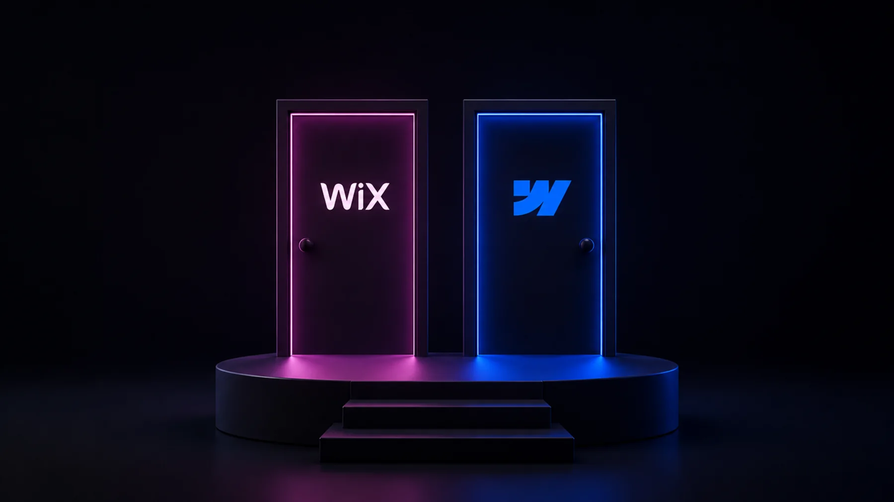

<aside class="prose_callout" aria-label="Key takeaways">

**Key takeaways**

- Webflow and Wix used to be easy to tell apart: Wix for beginners, Webflow for designers.
- In 2026 that line has blurred, mostly because of Wix Studio, the professional version of Wix aimed at agencies and advanced users.
- This guide compares Webflow against both standard Wix and Wix Studio, covering where each one wins on design, CMS, SEO, and pricing, and how to decide based on what your site needs to do.
- The short version: Wix is excellent for fast, simple sites and small businesses, Wix Studio narrows the gap for design work, but Webflow still leads for content-heavy, marketing-driven sites that need to scale.

</aside>

## The Webflow vs Wix comparison changed in 2026

For years, comparing Webflow and Wix was simple. Wix was the easy drag-and-drop builder for beginners and small businesses. Webflow was the professional tool for designers and agencies who wanted full control. If that’s how you’ve always thought about these two, you weren’t wrong. That’s exactly how both platforms positioned themselves for a long time.

But in 2026, those labels have started to break down, and an honest comparison has to acknowledge why. Wix has been working hard to move beyond its beginner-builder reputation, especially with Wix Studio, its push toward agencies and larger organizations. At the same time, Webflow has been moving deeper into the business and team space with stronger collaboration, AI tools, and features like localization. The two are no longer at opposite ends of a simple line.

So this isn’t a “pro tool versus easy tool” comparison anymore. It’s a more interesting question: now that Wix has a serious professional offering, where does Webflow still lead, and where does Wix genuinely win? This guide answers that honestly, from the perspective of a Webflow agency that pays attention to what the competition is actually doing well.

## Standard Wix vs Wix Studio: which are we comparing?

Before comparing anything, there’s a distinction that most Wix versus Webflow articles skip, and skipping it makes the whole comparison misleading. There are two versions of Wix, and they’re aimed at very different people.

Standard Wix is the original drag-and-drop builder. It’s designed for beginners, small business owners, and anyone who wants to get a good-looking site online fast without thinking about technical details. You drag elements onto the page, the AI can generate a layout for you, and you’re live in hours. This is the Wix most people picture.

Wix Studio is the professional version of the Wix ecosystem, built for agencies, freelancers, and advanced users. It adds a true responsive grid system, reusable components, and more scalable workflows, which are the things standard Wix historically lacked. Wix Studio is Wix’s real answer to Webflow, and it closes a lot of the gap that older comparison articles still describe.

This matters for the rest of the guide. When we say Webflow leads on design control, that gap is large against standard Wix and much smaller against Wix Studio. So throughout this comparison, the honest framing is: standard Wix and Webflow are aimed at different users, while Wix Studio and Webflow are genuine competitors. We’ll be clear about which one we mean where it matters.

| Area               | Standard Wix              | Wix Studio              | Webflow                |
| ------------------ | ------------------------- | ----------------------- | ---------------------- |
| Best for           | Beginners, small business | Agencies, pro projects  | Growing B2B, marketing |
| Design control     | Drag-and-drop, limited    | Responsive grid, strong | Pixel-level, top end   |
| Learning curve     | Easiest                   | Moderate                | Steepest               |
| CMS                | Basic                     | More capable            | Built for scale        |
| SEO control        | Improved, AI tools        | Improved                | Full technical control |
| Launch speed       | Fastest                   | Fast                    | Slower, more setup     |
| All-in-one         | Fully bundled             | Bundled                 | More modular           |
| Scales as it grows | Limited                   | Better                  | Built to scale         |
| Entry pricing      | From ~$17/mo              | From ~$17/mo            | From ~$14/mo           |

## When each one fits

Each platform suits a different kind of team and project. Here’s where each one is the better call.

### When Wix is the right choice

Wix, in both forms, genuinely wins in a set of situations, and it would be dishonest to pretend otherwise. Here’s where it’s the smarter pick.

If you’re a beginner or a small business owner who wants a professional site online fast, standard Wix is hard to beat. The drag-and-drop editor is genuinely intuitive, the AI site generator can produce a starting layout from a few questions, and you can go from nothing to live in hours without any technical knowledge. For a local business, a personal brand, or anyone who values speed and simplicity over control, Wix delivers exactly that.

If you want everything built in with no assembly, Wix’s all-in-one approach is a real strength. Hosting, security, e-commerce, booking, email marketing, and business tools come bundled. You don’t think about plugins or integrations. For a business owner who wants to run their business rather than their website, that bundling is genuinely useful.

If you need to launch microsites or campaign pages fast, Wix is well suited to it. Even large companies like Walmart, Nikon, and Renault Group use Wix, not for their main sites, but for microsites and subsidiary pages that need to go live quickly. That’s a real and sensible use case, and Wix handles it well.

If you’re an agency or freelancer who wants a faster, simpler workflow than Webflow for certain projects, Wix Studio is now a credible option. Its responsive grid and reusable components make it capable for professional work, and for some teams the gentler learning curve is worth the trade in control. It doesn’t match Webflow in every advanced area, but it’s a real tool, not a toy.

The pattern is that Wix wins when speed, simplicity, and all-in-one convenience matter most, whether that’s a beginner building their first site or an agency moving fast on a straightforward project. For those cases, Wix is the right call, not a compromise.

### When Webflow is the better choice

Webflow becomes the better platform when a site needs to do serious, scalable work, especially for content-driven and marketing-led businesses. Here’s where it still leads, including against Wix Studio.

The clearest reason is design control at the top end. Webflow gives pixel-level command over layout, animation, and responsive behavior, and generates clean, professional code underneath. Wix Studio has closed part of this gap with its responsive grid, but for the most demanding design work, building a precise brand system, complex interactions, fully custom layouts, Webflow still offers more control and cleaner output. For a company whose site is a core brand asset, that ceiling matters.

The second reason is content at scale. [Webflow’s CMS](https://webflow.com/cms) handles complex, interrelated content, relational references, dynamic filtering, and template pages that generate from CMS data. For a serious blog, a growing case study library, a resource center, or programmatic landing pages, Webflow’s CMS is built for that scale in a way Wix’s is not. Wix can manage content, but as it grows into hundreds of structured items, Webflow’s CMS is the stronger engine.

The third reason is marketing autonomy and stability at scale. Webflow lets a marketing team build, test, and ship without a developer, and sites tend to stay stable and fast as they grow. Wix performance depends heavily on how the builder is used; adding many third-party apps or heavy elements can slow a site down. For a growing site that needs to stay fast and let marketing move quickly, Webflow tends to be more predictable over time.

The fourth reason is SEO control. Webflow gives complete control over technical SEO, with editable meta titles, descriptions, and alt text at both static and CMS levels, plus clean code that search engines and AI tools read easily. Wix has improved its SEO tools and added AI features, but for a serious organic strategy, Webflow’s level of control is still ahead.

The honest framing is that Webflow is the better choice when control, content scale, marketing speed, and long-term SEO matter more than launch speed and simplicity. That’s usually a growing, content-driven business with a marketing team, which is a different situation from the small business or fast microsite that Wix serves so well.

## The details that matter

Where the two genuinely differ, feature by feature.

### Design and customization

This is where the standard Wix versus Wix Studio distinction matters most, so it’s worth being specific.

Against standard Wix, Webflow’s design advantage is large. Standard Wix uses a simpler drag-and-drop model that’s easy to learn but limits fine control, especially over responsive behavior across devices. Webflow gives granular control over every element and breakpoint, with clean code underneath. For any design-led project, Webflow is clearly ahead of standard Wix.

Against Wix Studio, the gap narrows. Wix Studio added a true responsive grid system, reusable components, and more professional workflows, which address the biggest historical complaints. For many professional projects, Wix Studio is now genuinely capable. Webflow still leads at the top end, with more precise control and cleaner output for the most demanding work, but the difference is smaller than older articles suggest, and for some projects Wix Studio’s faster workflow is a fair trade.

The honest summary on design: if you’re comparing Webflow to standard Wix, Webflow wins on control comfortably. If you’re comparing Webflow to Wix Studio, both are capable professional tools, and the choice comes down to how much top-end control you need versus how fast you want to move. Either way, Webflow gives you the most design ceiling, and Wix gives you the faster path to a polished result.

### CMS and content scaling

If content is central to your strategy, the platforms diverge.

Wix handles content well for smaller, simpler needs. A blog, a portfolio, a modest collection of items, all of these work cleanly, and Wix Studio adds more capability for professional content work. For a business that publishes occasionally or runs a contained content operation, Wix is perfectly capable.

Webflow’s CMS is built for scale and complexity. It supports many interrelated content types, relational references between them, dynamic filtering and sorting, and templates that generate pages automatically from CMS content. For a marketing operation publishing case studies, comparison pages, integration pages, and a regular blog, all with custom structures, Webflow’s CMS does work that a simpler system isn’t designed for. As content grows from dozens of items into the hundreds, that depth becomes the difference between scaling smoothly and fighting the platform.

This matters most for content-driven and B2B companies. If publishing structured content over time is central to your growth, the CMS is the engine of your marketing, and Webflow gives that engine more room to run.

### SEO and pricing

Two practical factors that often decide the choice.

On SEO, Webflow leads. It gives complete control over technical SEO, editable meta titles, descriptions, and alt text at both static and CMS levels, plus clean, semantic code that’s easy for search engines and AI search tools to read. Wix has genuinely improved its SEO tools and added AI-assisted features, and for a straightforward site it’s adequate. But for a serious organic strategy where technical control matters, Webflow is still ahead.

On pricing, the two are close at the entry level. [Webflow’s paid plans](https://webflow.com/pricing) start at around $14 a month and [Wix’s](https://www.wix.com/plans) at around $17, so there’s little between them to start. Both also offer free tiers to test, though Wix’s free plan is more functional for a live site while Webflow’s free tier is mainly for staging. As always, both platforms adjust pricing regularly, so check the current plans on their sites. The more meaningful cost difference is the same as with any Webflow comparison: serious Webflow work often involves an agency or developer, so the total investment reflects a different class of site, not just a different subscription.

## A decision framework

Here’s the simplest way to decide, based on everything above.

### Choose Wix if most of these are true:

- You’re a beginner or small business that wants a professional site online fast
- You want everything bundled with no technical setup
- You’re launching microsites or campaign pages that need to go live quickly
- You value speed and simplicity over fine-grained control
- You’re an agency wanting a faster, simpler workflow for a straightforward project (Wix Studio)

### Choose Webflow if most of these are true:

- You’re a growing, content-driven company, often B2B
- Your website is a core brand asset that needs precise design control
- You’re publishing content at scale, with a blog, case studies, or a resource library
- Your marketing team needs to move fast and the site needs to stay fast as it grows
- Serious technical SEO is a real growth channel
- You need the highest design ceiling, even compared to Wix Studio

The honest summary. Wix is excellent at what it’s for: getting a site live fast, with everything included, and with Wix Studio it’s now a credible professional tool too. For beginners, small businesses, fast microsites, and some agency projects, it’s a smart choice. Webflow is the better pick when control, content scale, marketing speed, and long-term SEO matter more than launch speed, which usually means a growing, content-driven business with a marketing team. The honest takeaway isn’t that one platform beats the other. It’s that the line between them has blurred, so the right choice depends more than ever on what your specific site needs to do, now and as it grows.

## Frequently asked questions

### Which is easier for beginners, Webflow or Wix?

Standard Wix, by a wide margin. Its drag-and-drop editor and AI site generator let a complete beginner build a site fast with no technical knowledge. Webflow is far more capable but has a real learning curve. For someone who just wants their own site up quickly, Wix is the easier path.

### Can you migrate from Wix to Webflow?

Yes, though it’s a rebuild rather than an automatic transfer. Content is recreated in Webflow’s CMS and the design is rebuilt, with a redirect map to preserve your SEO. Teams usually make this move when they outgrow Wix and need more design control, CMS depth, or technical SEO.

### Is Wix Studio good enough to replace Webflow?

For many professional projects, Wix Studio is now genuinely capable, with a real responsive grid and reusable components. Webflow still leads at the top end for the most demanding design, cleaner code, and deeper CMS and SEO control. For a content-heavy, growth-focused site, Webflow stays ahead; for a faster workflow on a straightforward project, Wix Studio is a fair option.

### Is Webflow or Wix better for SEO?

Both have improved, but Webflow offers deeper technical SEO control and cleaner code, which matters for a serious organic strategy. Wix is adequate for a straightforward site. For a business where SEO is a real growth channel, Webflow’s level of control is the stronger choice.
